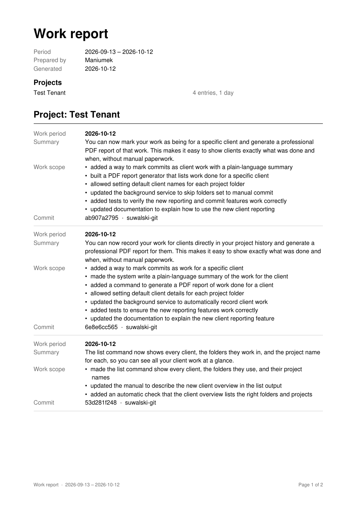

# suwgit

**Your work, committed for you, and a report for your client.**

suwgit watches your git repositories and commits what you leave uncommitted,
under a clear message written by an AI model running on **your own server**.
No code leaves your network.

Working B2B? The same commits become a record of the work you did for a client,
in plain language a non-technical client understands, and one command turns
them into a PDF report.

```
[feature] added revenue chart to main page dashboard
[refactor,bugfix] added builder schema for report creator and fixed main tab not opening
```

## What you get

- **Nothing left uncommitted.** Register a repository and forget it. Every
  interval a background service commits whatever you have stopped working on.
  It waits while you are still editing.
- **Messages worth reading.** Each commit says what changed, labelled `feature`,
  `bugfix`, `refactor` and so on, so you can find anything later.
- **Proof of work for clients.** Mark a commit as client work and it records
  what was done, for which project and when, written for the client rather
  than for developers.
- **A PDF report in one command.** Every piece of work for a client over any
  date range, grouped by project. No spreadsheet, no time tracker, no database.
- **Safe by default.** It refuses to commit anything that looks like a password
  or an API key. It never force-pushes and never pulls on your behalf. Pushing
  is off until you turn it on.

## The report

```bash
suwgit report --tenant lokum
```



Each entry shows when the work was done, a short summary, the work behind it,
and the commit that proves it. By default the report covers the last 30 days
and shows days only:

| option | what it does |
|---|---|
| `--from 2026-09-13 --to 2026-10-13` | any range, both days included; dates as `YYYY-MM-DD` |
| `--time` | add the hours of every piece of work |
| `-o ~/invoices/` | where to save it: a file or a folder (default: the current folder, as `lokum--<today>.pdf`) |
| `--format json` | print the report as JSON instead, for scripts: `suwgit report --tenant lokum --format json \| jq` |

The report lists only your own commits, from every repository where you did
work for that client, on every branch.

## Recording work for a client

A client gets a **tenant**: a short working name only you see, such as `lokum`.
Commit with it:

```bash
suwgit commit --b2b lokum --project "Lokum Shop"
```

```
[feature] added order checkout flow

Summary: Customers can now pay for their order directly in the shop, and orders with a wrong total are stopped before payment.

Work-Scope:
- added a checkout page where customers enter their address and pay
- made the shop double-check the order total before taking payment

Project: Lokum Shop
Tenant: lokum
Work-Period: 2026-10-12T09:14+02:00/2026-10-12T11:04+02:00
```

The title stays technical, for you. The **Summary** and **Work-Scope** are for
the client: what changed for them, in plain words. **Project** is the name the
client sees, and the folder name if you give none. The tenant never appears in
the report.

### Less typing

Tell a repository who it works for, once:

```bash
suwgit register ~/projects/shop --default-b2b lokum --default-project "Lokum Shop"
```

| in that repository | commits as |
|---|---|
| `suwgit commit` | an ordinary commit |
| `suwgit commit --b2b` | client work for `lokum`, project Lokum Shop |
| `suwgit push --b2b acme` | client work for `acme` instead |
| the background service | client work for `lokum`, every time |

Without a default, a bare `--b2b` offers what you used last time in that
repository and asks first. Enter confirms, and `-y` skips the question:

```console
$ suwgit push --b2b
Commit and push shop as B2B for lokum, project Lokum Shop (last used here)? [Y/n]
```

If a repository mixes client work with your own, register it with
`--no-auto-commit` and commit by hand. Then only what you mark with `--b2b`
counts as the client's.

## Install

You need Linux with systemd, Python 3.12+, git, and a
[vLLM](https://github.com/vllm-project/vllm) server, or anything else that
speaks the OpenAI chat-completions API. There is nothing else to install.

```bash
git clone https://github.com/Manomenu/suwalski-git ~/repos/suwalski-git
cd ~/repos/suwalski-git
./bin/suwgit init
```

`init` asks for your server, how often to commit, whether to push, and your
name for reports ("Prepared by"). It then sets up the background service. Run
it again any time: every question offers your current answer, so Enter keeps
it. Open a new terminal, then:

```bash
suwgit register ~/projects/dashboard
suwgit list
```

## Commands

| command | what it does |
|---|---|
| `suwgit init` | set up, or change the setup; safe to run again |
| `suwgit register <folder>` | watch a repository; run again to change its settings: `--default-b2b <tenant>`, `--default-project <name>`, `--no-auto-commit` |
| `suwgit unregister <folder>` | stop watching it |
| `suwgit list` | the setup, every repository and whether it has changes, and every client as `tenant, folder (project)` |
| `suwgit commit [path]` | commit now; `--b2b [tenant]` / `--project [name]` for client work, `-y` to skip the question, `--push` / `--no-push` |
| `suwgit push [path]` | commit now and push |
| `suwgit report --tenant <tenant>` | the PDF report; see [above](#the-report) |
| `suwgit logs [-n N] [-f]` | what the background service did |
| `suwgit uninstall [--purge]` | remove suwgit; your config stays unless `--purge` |

## When something goes wrong

If suwgit cannot commit a repository, because the AI server is down, a secret
was spotted or the push was rejected, it leaves a `.suwgit.log` note in that
repository saying why. The note disappears as soon as the problem is gone. A
secret is never committed: the changes stay in your working tree for you to
check.

## More

- [How it works](docs/how-it-works.md): the commit flow, the AI model's
  instructions, the B2B commit format, how the report is built, configuration
  reference and file locations.
- [TODO](TODO.md): what is planned next.

## License

[MIT](LICENSE)
